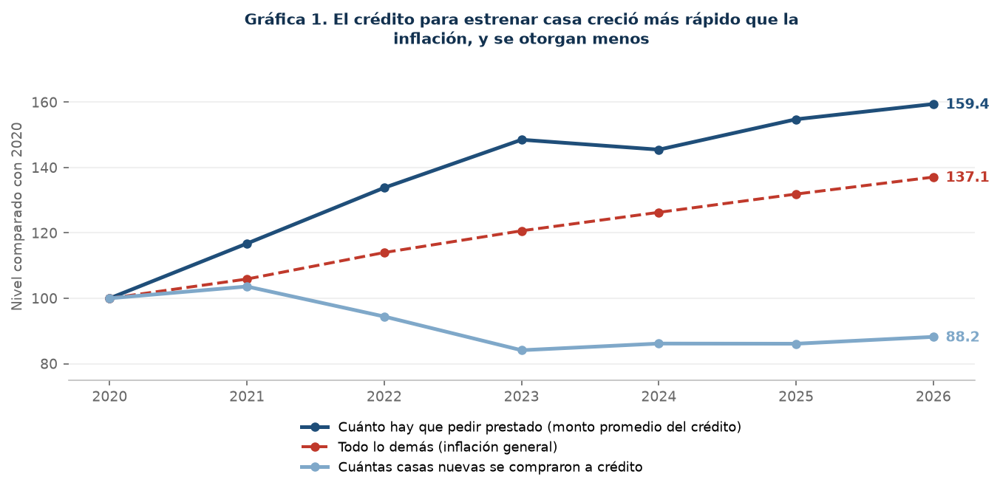

**Estrenar casa se volvió un lujo**

Cómo el encarecimiento de la vivienda nueva dejó fuera a las familias que menos ganan

Alejandro Muñoz Fernández

**¿Quién dejó de poder estrenar casa en México, y por qué?** Comprar vivienda nueva ha sido la manera en que una familia mexicana de ingreso medio o bajo empieza a construir patrimonio. Hoy, esa operación cuesta más y es accesible para menos familias: el crédito que hay que pedir es **16% más grande que hace seis años**, ya descontada la inflación, y **se otorgan 12% menos créditos para comprar casa nueva**. En los últimos años **la tendencia creciente es la vivienda usada, que ya concentra casi la mitad del crédito para comprar casa.**

> **Entre 2020 y 2026, el crédito promedio para comprar casa nueva subió 59%, mientras que la inflación subió 37%.**

**El precio de la vivienda duplica a la inflación**

El precio de la vivienda en México subió 8.9% al cierre de 2025 y 7.9% en el primer semestre de 2026. La inflación, es decir, el aumento generalizado de precios, fue de 3.9% entre mayo de 2025 y mayo de 2026. **El precio subió más rápido en el segmento económico-social**: 10.7% en 2024, 11% en 2025 y 10% en el primer semestre de 2026, mientras que la vivienda de gama media pasó de 8.4% a 7.4% y luego a 6.7% en 2026.

Los insumos de la construcción residencial influyen en el precio, en 2022 subieron 10.1% y desde entonces aumentan menos, 3.94% en 2023, 3.93% en 2024 y 4.84% entre abril de 2025 y abril de 2026. **El precio de la vivienda subió casi el doble de lo que subieron esos costos,** así que los insumos explican poco más de la mitad del alza. Aun así, el alza de costos pesa más en el producto barato, donde consume más margen, por lo que **la vivienda económica es la más expuesta a los cambios en el precio de los insumos.**

**El aumento del precio de la vivienda se refleja en el crédito otorgado**

El monto promedio del crédito para comprar casa nueva pasó de **745 mil pesos en 2020 a 1 millón 188 mil en 2026: un incremento de 59%**. En ese mismo periodo, los precios al consumidor subieron 37%. Descontada esa inflación, **estrenar casa cuesta 16% más de lo que costaba hace seis años.**

Desde 2021 el **monto del crédito no sigue la misma tendencia de la inflación**, y la brecha se abre sobre todo entre 2021 y 2023 sin que vuelva a cerrarse. El **número de créditos otorgados** también muestra un escenario desfavorable, pues **cae 16% entre 2020 y 2023, y después no se recupera**. Para 2026 sigue 12% por debajo del nivel de 2020 (gráfica 1).

**Gráfica 1. El crédito para estrenar casa creció más rápido que la inflación, y se otorgan menos**

<picture>
  <source media="(prefers-color-scheme: dark)" srcset="figuras/grafica_1_credito_inflacion_dark.png">
  
</picture>

Fuente: SNIIV (Conavi-Sedatu), registro de financiamientos, créditos de adquisición de vivienda nueva, e INPC (INEGI). Cálculos propios.

Nota: Cada punto compara el año con 2020, que vale 100. Un valor de 137 significa 37% por encima del nivel de 2020. Se usa el acumulado de enero a mayo de cada año. Los datos son a nivel nacional.

**Quién se quedó sin acceso a la vivienda nueva**

En 2026 se otorgan 12% menos créditos para vivienda nueva que en 2020. Pero lo revelador no es cuántos, sino a quiénes dejaron de darse. De los créditos que se otorgan para estrenar casa, los que van a **personas del rango de ingreso más bajo eran 15.9% en 2020 y son 7.4% en 2026.** La caída tampoco fue gradual. Esa proporción todavía subió hasta 17.5% en 2022 y se desplomó a partir de 2023, **hasta quedar en menos de la mitad de 2020**. No es un hallazgo nuevo para el gobierno: las reglas de 2025 del programa federal de vivienda social citan al Coneval para decir que cerca de **73.6 millones de mexicanos están prácticamente excluidos del mercado formal de vivienda porque su hogar no llega a cinco salarios mínimos.**

A la par de esa falta de acceso a la vivienda nueva, **han crecido las compras de vivienda usada**, **que pasaron de 35.3% de las compras a crédito en 2020 a 46.6% en 2026**. En números son 60,627 créditos para casa usada en los primeros cinco meses de 2020 y 85,718 en los mismos meses de 2026, 41% más.

Del lado de la oferta de vivienda nueva, en cambio, hoy **sólo una de cada 186 viviendas es del segmento económico, el que cuesta menos de medio millón de pesos.** Más de la mitad del registro es popular, que ronda los 600 mil, y una cuarta parte tradicional, arriba de 675 mil. Y la poca vivienda económica que queda tiene una tendencia a la baja. Durante todo 2025 el registro contó entre 2,365 y 2,932 viviendas cada mes, y en 2026 cae de 2,520 en enero a 1,909 en junio. **El primer semestre de 2026 queda 21% por debajo del de 2025.**

**Qué significa esto para una familia**

Una familia que hace seis años quería estrenar casa pedía prestados unos 745 mil pesos. **Hoy pide casi un millón doscientos mil. Subió 59%**, mientras que los precios en general subieron 37%.

Un crédito más grande significa un enganche más alto y una mensualidad más pesada por muchos años. Ahí es donde muchas familias dejan de calificar. **De cada 100 créditos para casa nueva, en 2020 casi 16 iban al segmento de ingreso más bajo. Este año son 7.**

**Quien no alcanza una vivienda nueva compra una usada. Esos créditos pasaron de 60 mil a 86 mil en seis años.** Otra opción es que las familias se anoten en el programa Vivienda para el Bienestar, que desde 2025 construye casa nueva para hogares de bajo ingreso y la entrega con crédito sin intereses. En año y medio lleva 667 mil viviendas contratadas y 89 mil entregadas, y esperar es parte del trato.

**Rentar casi no es opción: sólo 16% del parque habitacional se usa para renta**, un mercado que la OCDE considera demasiado chico para sustituir a la compra. Y más de seis de cada diez casas propias las construyó su propio dueño.

**Para quien toma decisiones**

El problema no es cuánto crédito se otorga, sino qué se puede comprar con él. El precio sube al doble de la inflación y el costo de construir explica sólo una parte**. Lo que falta por explicar es por qué hay cada vez menos vivienda barata en oferta**, que cayó 21% entre 2025 y 2026. Mientras eso siga, **ampliar el crédito sólo permite pedir más prestado por la misma casa.** La OCDE hizo ese diagnóstico para México en 2024, que los hogares de ingreso medio y bajo no pueden comprar por el precio y por el crédito limitado.

**Hasta dónde llegan estos datos**

- **El monto promedio del crédito no es el precio de la vivienda.** Mezcla el precio con cuánto presta cada institución, con el enganche y con el perfil de quien califica. Si los créditos más chicos dejaron de otorgarse, el promedio sube sin que ninguna casa haya cambiado de precio. Por la misma razón, la caída del rango de ingreso más bajo puede reflejar que esas personas dejaron de comprar o que cambió la forma de registrar su ingreso.

- **Esto no dice que falte vivienda en México.** El déficit habitacional de 2024 es 96% rezago, casas que ya existen y no cumplen lo mínimo en materiales, espacio o servicios, y sólo 4% necesidad de vivienda nueva. Lo que documenta este ejercicio es un problema de acceso a la casa nueva, no de escasez de casas.

**Siguientes pasos.** Haría falta dar seguimiento al precio de venta de la vivienda nueva por segmento frente al ingreso del hogar, y a las viviendas del programa Vivienda para el Bienestar hasta su entrega. La OCDE recomendó a México ampliar la oferta asequible con inversión privada y alianzas público-privadas, y desarrollar un mercado de renta social; sin ese cruce de precio e ingreso, no hay manera de saber a quién le alcanzaría.

**Fuentes y nota metodológica**

SNIIV, Sistema Nacional de Información e Indicadores de Vivienda (Conavi-Sedatu): registro de financiamientos 2020 a 2026, registro de oferta de vivienda nueva 2020 a 2026 y déficit habitacional 2024. INEGI: Índice Nacional de Precios al Consumidor, e Índice de Precios al Productor de la construcción residencial, difundido por el CEICO de la CMIC. SHF: Índice SHF de Precios de la Vivienda, boletines del cuarto trimestre de 2024, del cuarto trimestre de 2025 y del segundo trimestre de 2026, de donde provienen las variaciones nacionales y las de cada segmento. OCDE: Maravalle, Caldera Sánchez y González Pandiella, Improving Housing and Urban Development Policies in Mexico, Economics Department Working Papers núm. 1801 (2024), de donde provienen el 16% de parque en renta y el 60% de autoconstrucción. Reglas de Operación del Programa de Vivienda Social 2025 (Conavi, DOF), de donde proviene la cifra del Coneval. Vivienda para el Bienestar (Sedatu, Conavi, Infonavit y Fovissste): avance del programa a septiembre de 2026. Enlaces: sniiv.sedatu.gob.mx/Reporte/Datos_abiertos · inegi.org.mx/temas/inpc · gob.mx/shf · cmic.org.mx/ceico · doi.org/10.1787/c2229c19-en · dof.gob.mx

Los años del registro de financiamientos se comparan de enero a mayo, incluida la distribución por rango de ingreso, y se clasifican con la variable de destino, no con la de modalidad, cuyos códigos cambian de significado en 2026. En el registro de oferta la clasificación por segmento cambia en 2024, así que su serie arranca en 2025, y entre noviembre de 2025 y enero de 2026 pasa de 209 mil a 322 mil viviendas, casi todo del segmento popular: es alta de desarrollos, no obra nueva. Los demás segmentos se mueven poco y sí se comparan de un año a otro. Los segmentos del registro de oferta son rangos de precio en UMA, convertidos a pesos con la UMA mensual de 2026, de 3,566.22. La variable de subsidio marca elegibilidad, no identifica al constructor, así que no se usó. Procesamiento propio en Python, disponible para replicar en este [repositorio](https://github.com/alexmufe/vivienda-nueva-mexico).
